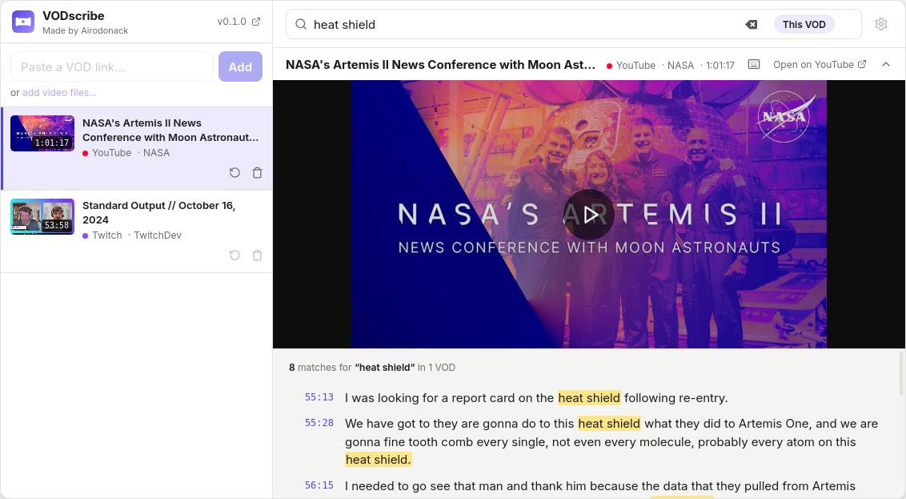

<p align="center">
  
</p>

<h1 align="center">VODscribe</h1>

VODscribe is a desktop app that turns Twitch, YouTube and Kick VODs into searchable transcripts and clips for your editor.



Try it in your browser first: the demo at [vodscribe.com](https://vodscribe.com) is the app itself, on two transcribed VODs.

## What works

- Plays Kick, Twitch and YouTube VODs. Links from over a thousand other sites work too, and so do video and audio files on your computer.
- Transcribes on your computer. It knows English and 24 other European languages, with NVIDIA's Parakeet speech model.
- Searches everything said and typed. One search covers the transcripts and chat replays of every VOD in your library.
- Shows the chat replay. Kick, Twitch and YouTube livestreams get their chat beside the transcript, and a timeline of how busy it was.
- Drags clips into your editor. Pick lines or mark a stretch, then drag the clip into your editor or a folder.
- Joins clips into edits. An edit takes pieces of one VOD or many and renders them as one video.
- Brings chapters and highlights. A channel's VODscription adds chapters, highlights and who is speaking to its VODs.

## What doesn't yet

- The installers aren't code-signed. Windows and macOS warn before the first start.
- Only European languages are transcribed. Names and game terms are sometimes misspelled.
- Live streams can't be added. Add one once its VOD is up.
- The GPU add-on needs an NVIDIA card. It runs on Windows and Linux; a Mac transcribes on its processor.
- VODscription sign-up isn't open. Published VODscriptions work in the app for everyone.

## Install

Download VODscribe from [vodscribe.com](https://vodscribe.com/#download). It runs on 64-bit Windows 10 and 11, macOS 12 and later on Apple silicon and Intel, and Linux as a .deb or .rpm package.

To open it the first time on Windows, choose More info, then Run anyway. On a Mac, drag VODscribe into Applications, open it, choose Done, then Open Anyway in System Settings › Privacy & Security and enter your password. On macOS 14 or earlier, Control-click it in Applications and choose Open.

On first start it downloads what it needs to transcribe, about 1 GB, and checks each file.

## Your first transcript

1. Paste a VOD's link into "Paste a VOD link…" at the top of the library, or drop a video file on the window.
2. Press Transcribe on its row; nothing is transcribed until you ask.
3. Type a phrase into "Search for a phrase…" while it works, and click a result to play from there.

## Everyday use

- **Clips.** Pick lines in the transcript, or press I and O to mark a stretch, press C, and drag the clip from the clip bar under the player into your editor or a folder.
- **Edits.** Drag a clip onto "Make new edit" in the library, then open the edit to cut and order its pieces.
- **Clip format.** Clips are MP4 with H.264 unless Settings › Encoding picks H.265, DNxHR or ProRes, at a Proxy, Standard or High quality. DaVinci Resolve on Linux needs DNxHR or ProRes.
- **Keys.** The keyboard button at the right of the player's controls lists them, and Settings › Controls changes them.
- **Search.** Quote a phrase to match it exactly, and add `from:name` to search one chatter's messages.
- **Updates.** VODscribe checks at start and once a day, and installs only when you say so; [vodscribe.com/releases](https://vodscribe.com/releases) has every version's changes.

Your library, transcripts and searches stay on your computer. There is no account and nothing is collected. The [privacy page](https://vodscribe.com/privacy) lists every server the app talks to. Everything is in VODscribe's data folder:

- Linux: `~/.local/share/app.vodscribe`
- macOS: `~/Library/Application Support/app.vodscribe`
- Windows: `%APPDATA%\app.vodscribe`, with downloads and caches in `%LOCALAPPDATA%\app.vodscribe`

## Reporting a problem

Report a bug or suggest an idea on the [support page](https://vodscribe.com/support), which opens a form on [GitHub](https://github.com/Airodonack/VODscribe/issues/new/choose), or write to support@vodscribe.com. Report a security problem privately, as [SECURITY.md](SECURITY.md) says.

## Licence

VODscribe is source-available under the [Functional Source License, Version 1.1, ALv2 Future License](LICENSE.md). You may use, read, change and share it for anything but a competing product. Each version becomes Apache 2.0 two years after its release. The software it is built on keeps its own licences, listed in `apps/desktop/src-tauri/THIRD-PARTY-NOTICES.txt` and on the [licenses page](https://vodscribe.com/licenses).

## Building from source

VODscribe is a Tauri 2 app: a Svelte 5 page in the system's web view, a Rust shell around it, and Rust crates that do the work. The JavaScript side is a pnpm workspace and the Rust side a Cargo workspace, both rooted here.

- [`apps`](apps): the desktop app and the website.
- [`crates`](crates): the library and transcription, the player, the transcription worker, and dragging files in and out.
- [`scripts`](scripts): the sidecar build, release packaging and checks.
- [`tests`](tests): the end-to-end harness.
- [`third_party`](third_party): patched copies of crates.
- [`tools`](tools): the speech model's export.
- [`licenses`](licenses): what the third-party notices are made from.
- [`.github`](.github): CI workflows, Dependabot and the issue forms.
- [`.githooks`](.githooks): checks before a commit.
- [`.cargo`](.cargo): Cargo settings for Windows builds.
- `Cargo.toml`, `pnpm-workspace.yaml`, `package.json`: the two workspaces; `Cargo.toml` holds the app's version.
- `rust-toolchain.toml`, `.nvmrc`, `rustfmt.toml`: the Rust and Node versions, and rustfmt's settings.
- `Cargo.lock`, `pnpm-lock.yaml`, `.gitignore`: the locked dependencies, and what Git ignores.
- `CHANGELOG.md`: each version's changes, also its release notes and the site's releases page.
- `CONTRIBUTING.md`, `SECURITY.md`, `LICENSE.md`: contributing, reporting a vulnerability, and the licence.

You need Rust, Node, pnpm, ffmpeg and [Tauri's system dependencies](https://tauri.app/start/prerequisites/). `pnpm dev` runs a bash script, so on Windows it needs Git Bash on `PATH`. Release builds on Linux also need `patchelf`.

```sh
git config core.hooksPath .githooks   # once per clone
pnpm install
pnpm dev          # the desktop app, through tauri dev
pnpm site         # the website, at localhost:5173
pnpm check        # type-check every app
pnpm format       # Prettier on every app; pnpm lint only checks
cargo fmt --all   # rustfmt
```

CI refuses unformatted code. The transcription worker is a Tauri sidecar: `pnpm dev` builds it, and `bash scripts/prepare-sidecars.sh [debug|release]` builds it before a plain `cargo` build or after a change to the worker. `pnpm tauri build` in `apps/desktop`, after `prepare-sidecars.sh release`, makes the installers for this system.

The tests:

- `cargo test -p vodscribe-core`, `-p vodscribe-player`, which needs ffmpeg, and `-p vodscribe`, after `prepare-sidecars.sh`.
- The page's `*.test.mjs` files, with `node --test`, as `.github/workflows/check.yml` lists them.
- The end-to-end scenarios in [`tests/e2e`](tests/e2e), which drive a built app as a person would.

After changing dependencies, regenerate `apps/desktop/src-tauri/THIRD-PARTY-NOTICES.txt` with `python3 scripts/third-party-notices.py`, which needs [cargo-about](https://github.com/EmbarkStudios/cargo-about) 0.9. CI fails when it is out of date.

The CLI runs the pipeline on a library of its own:

```sh
export VODSCRIBE_DATA=./vodscribe-data
cargo run --release -p vodscribe-core --bin vodscribe-cli -- setup
cargo run --release -p vodscribe-core --bin vodscribe-cli -- add <url>
cargo run --release -p vodscribe-core --bin vodscribe-cli -- add-file <path>
cargo run --release -p vodscribe-core --bin vodscribe-cli -- search "some phrase"
```
